# De Wikimedianen (HackaLOD 2026)
Dit is de GitHub repository van team De Wikimedianen tijdens de [HackaLOD 2026, 30-31 oktober 2026, Middelburg](https://netwerkdigitaalerfgoed.nl/hackalod/). Het resultaat is de website **[De Siboga-expeditie](https://siboga.nl)**.

> In 1899 voer de Siboga door de zeeën van Nederlands-Indië, het huidige Indonesië. Aan boord: wetenschappers die alles in en rond de zee onderzochten. Ze vonden enorm veel planten en dieren, veel ervan nog niet beschreven. Hun ontdekkingen veranderden hoe wetenschappers naar de natuur keken. Ontdek wie er meegingen, waar ze kwamen en wat ze vonden.

| | | |
| :---: | :---: | :---: |
| 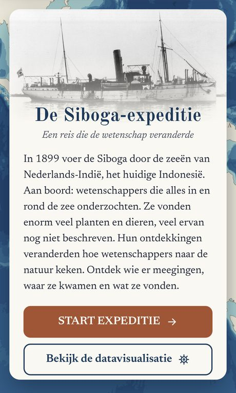 | 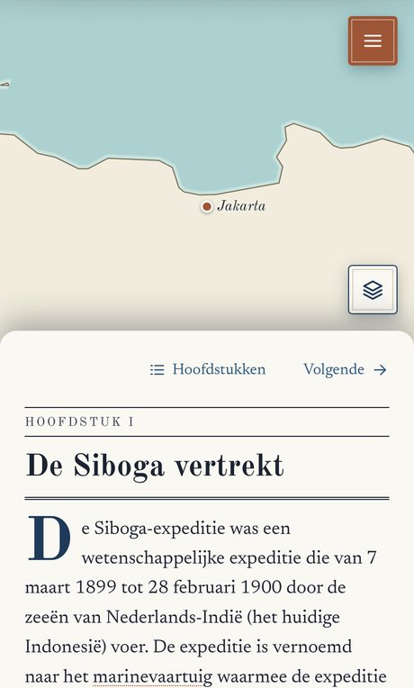 | 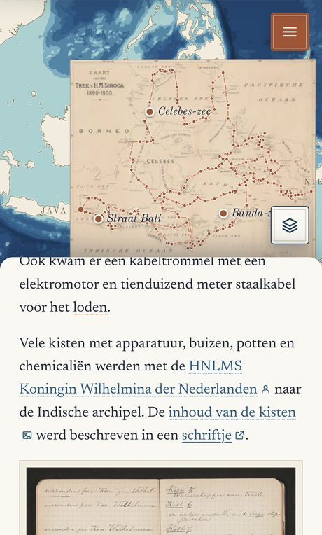 |
| Welkom | Hoofdstuk I: De Siboga vertrekt | De Kaart van den Trek over de moderne kaart |
| 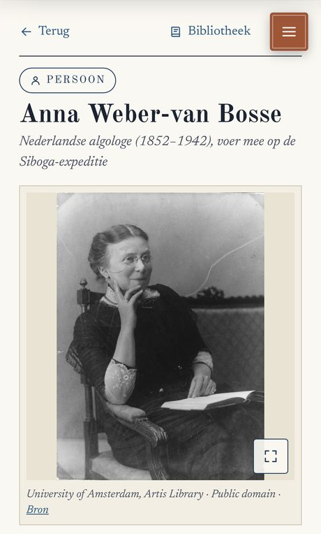 | 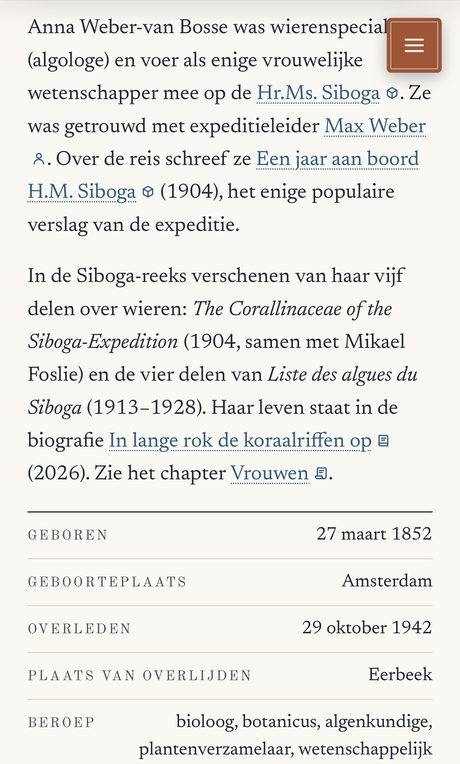 | 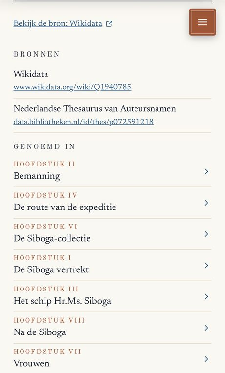 |
| Een persoon: Anna Weber-van Bosse | Met gegevens uit Wikidata | Bronnen, en in welke hoofdstukken ze voorkomt |
| 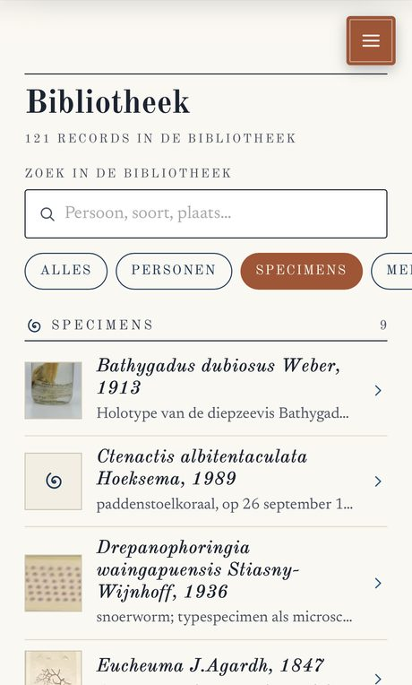 | 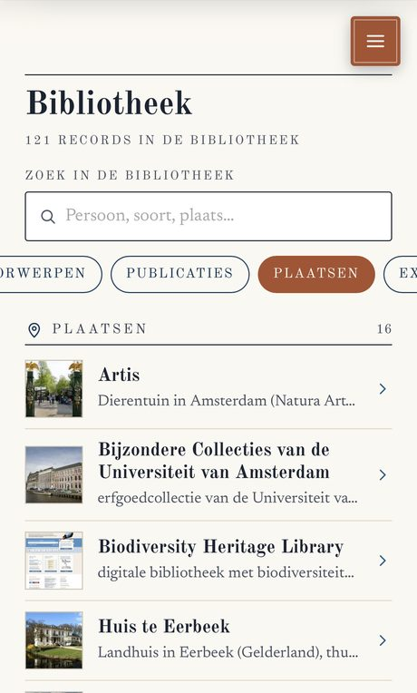 | 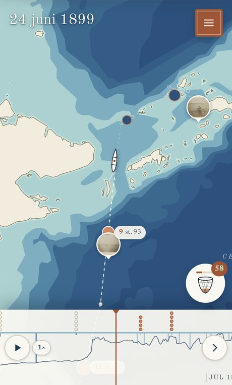 |
| De bibliotheek: specimens | De bibliotheek: plaatsen | De datavisualisatie |
| 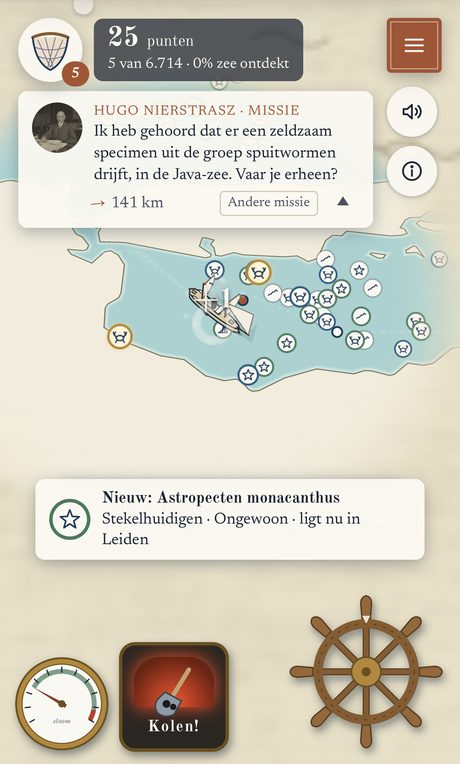 | | |
| Het spel | | |

# Over deze website
Deze website is gebouwd in het kader van de [HackaLOD 2026](https://netwerkdigitaalerfgoed.nl/agenda/hackalod-2026/).

## Collecties en databronnen
Voor deze site zijn onder meer deze databronnen, collecties en literatuur gebruikt. Bronnen met (NDE) staan in het [NDE-datasetregister](https://datasetregister.netwerkdigitaalerfgoed.nl/).

### Databronnen
- [Personen uit de Nederlandse Thesaurus van Auteursnamen (NTA)](https://datasetregister.netwerkdigitaalerfgoed.nl/datasets/http://data.bibliotheken.nl/id/dataset/persons) (NDE)
- [Cultuur-Historische Objecten (Rijksdienst voor het Cultureel Erfgoed)](https://datasetregister.netwerkdigitaalerfgoed.nl/datasets/https://linkeddata.cultureelerfgoed.nl/rce/datacatalog/id/dataset/db6193aa-84af-3edf-90fd-074a0a11248d) (NDE)
- [Wikidata](https://www.wikidata.org/)
- [Wikimedia Commons](https://commons.wikimedia.org/wiki/Main_Page)
- [GBIF](https://www.gbif.org/)
- [Biodiversity Heritage Library](https://www.biodiversitylibrary.org/)
- [World Register of Marine Species](https://www.marinespecies.org/)

Sommige van de foto's en kaarten zijn ontsloten via de [IIIF-standaard](https://iiif.io/).

### Collecties
- Naturalis Biodiversity Center
- Zoölogisch Museum Amsterdam
- Museum of Comparative Zoology
- Muséum national d'Histoire naturelle
- Natural History Museum, Londen
- NTNU Vitenskapsmuseet
- Bijzondere Collecties van de Universiteit van Amsterdam
- Stadsarchief Amsterdam
- KB, nationale bibliotheek

### Literatuur
- M. Weber (red.), *Siboga-Expeditie* (1901-1986)
- A. Weber-van Bosse, *Een jaar aan boord H.M. Siboga* (1904)
- G.M.W. Acda, *Op de deining van de wetenschap. Leven en werk van Gustaaf Frederik Tydeman (1858-1939), zeeofficier en hydrograaf* (2019)
- E.S. Hutcheson, *The Living Seas: Marine Algae, Symbiosis and the Modern Conception of Coral Reefs 1880-1930* (2023)
- A. Kieskamp, *In lange rok de koraalriffen op* (2026)
- *De expeditie der Siboga*, Het Vaderland, 24 juli 1899

### Kaart
- Diepte en land: Natural Earth
- Route: Kaart van den Trek v. H.M. Siboga (Weber-van Bosse, 1904)
- Historische kaart: Stadsarchief Amsterdam

## Team
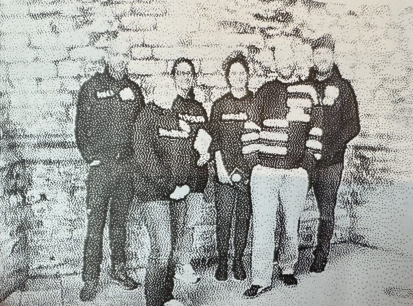

*Het team van siboga.nl tijdens de HackaLOD 2026. Van links naar rechts: Olaf Janssen, Sandra Fauconnier, Daniëlle Jansen, Annika Hendriksen, Hay Kranen en Daan van Ramshorst.*

## Auteursrecht en hergebruik
De teksten, de code en de eigen graphics van deze website, zoals de kaartlagen, de iconen en de kaart van de paddenstoelkoraal, stellen we vrij beschikbaar onder [CC0 1.0](LICENSE.md). Je mag ze zonder toestemming en zonder naamsvermelding gebruiken, aanpassen en verspreiden. De code staat in deze repository, de teksten in de [content-repo](https://github.com/hay/siboga-content).

Dat geldt niet voor de afbeeldingen die we van elders gebruiken, zoals foto's, platen en kaarten uit erfgoedcollecties. Die zijn publiek domein of hebben een eigen licentie; maker, licentie en bron staan bij elke afbeelding. Ook de logo's van het Netwerk Digitaal Erfgoed en Wikipedia vallen niet onder CC0. Citaten uit oude bronnen, zoals het reisverslag van Anna Weber-van Bosse uit 1904, zijn publiek domein.

# Uitleg en documentatie
De technische documentatie van de website staat in [docs/](docs/README.md). De codeconventies staan in [CLAUDE.md](CLAUDE.md). Het inhoudelijke overzicht van de expeditie staat in [expeditie/](expeditie/README.md).

# "Gratis" datavisualisaties, naast onze HackaLOD output
Doordat de expeditie, de stations en de mensen op Wikidata staan, kun je ze ook bekijken met tools die de Wikidata-community al gebouwd heeft.
- [Reasonator](https://reasonator.toolforge.org/?q=Q4201627): de Siboga-expeditie als overzichtspagina
- [Scholia](https://scholia.toolforge.org/Q4201627): publicaties en verbanden rond de expeditie
- [Kaart van de stations](https://query.wikidata.org/#%23title%3A%20Siboga%20Expedition%20%281899%E2%80%931900%29%3A%20route%20langs%20de%20stations%0A%23defaultView%3AMap%7B%22hide%22%3A%5B%22%3Fgeo%22%2C%22%3Frgb%22%5D%2C%22layer%22%3A%22%3Flayer%22%7D%0ASELECT%20%3Fitem%20%3FitemLabel%20%3Fdate%20%3Fgeo%20%3Flayer%20%3Frgb%20WITH%20%7B%0A%20%20%23%20All%20stations%20with%20coordinates%2C%20with%20a%20sort%20key%3A%20date%20%2B%20station%20number%20%2B%20suffix%0A%20%20SELECT%20%3Fitem%20%3Fcoord%20%3Fdate%20%3Fkey%20WHERE%20%7B%0A%20%20%20%20%3Fitem%20wdt%3AP31%20wd%3AQ141748032%20%3B%20%20%20%20%20%20%20%23%20instance%20of%3A%20sampling%20station%0A%20%20%20%20%20%20%20%20%20%20wdt%3AP625%20%3Fcoord%20%3B%20%20%20%20%20%20%20%20%20%20%20%20%20%23%20coordinate%20location%0A%20%20%20%20%20%20%20%20%20%20p%3AP793%20%3Fevent%20.%20%20%20%20%20%20%20%20%20%20%20%20%20%20%20%23%20significant%20event%0A%20%20%20%20%3Fevent%20ps%3AP793%20wd%3AQ4201627%20.%20%20%20%20%20%20%20%20%23%20%3D%20Siboga%20Expedition%0A%20%20%20%20OPTIONAL%20%7B%20%3Fevent%20pq%3AP585%20%3Fpit%20.%20%7D%20%20%23%20point%20in%20time%0A%20%20%20%20OPTIONAL%20%7B%20%3Fevent%20pq%3AP580%20%3Fstart%20.%20%7D%23%20start%20time%0A%20%20%20%20BIND%28SUBSTR%28STR%28COALESCE%28%3Fpit%2C%20%3Fstart%29%29%2C%201%2C%2010%29%20AS%20%3Fdate%29%0A%20%20%20%20%3Fitem%20rdfs%3Alabel%20%3Flabel%20.%20FILTER%28LANG%28%3Flabel%29%20%3D%20%22en%22%29%0A%20%20%20%20BIND%28STRAFTER%28%3Flabel%2C%20%22station%20no.%20%22%29%20AS%20%3Fno%29%0A%20%20%20%20BIND%28REPLACE%28%3Fno%2C%20%22%5B%5E0-9%5D%22%2C%20%22%22%29%20AS%20%3Fnum%29%0A%20%20%20%20BIND%28CONCAT%28%3Fdate%2C%20%22%7C%22%2C%20SUBSTR%28CONCAT%28%22000%22%2C%20%3Fnum%29%2C%20STRLEN%28%3Fnum%29%20%2B%201%29%2C%0A%20%20%20%20%20%20%20%20%20%20%20%20%20%20%20%20REPLACE%28%3Fno%2C%20%22%5B0-9%5D%22%2C%20%22%22%29%29%20AS%20%3Fkey%29%0A%20%20%7D%0A%7D%20AS%20%25stations%0AWITH%20%7B%0A%20%20%23%20For%20each%20station%3A%20the%20key%20of%20the%20next%20station%20in%20time%0A%20%20SELECT%20%3Fa%20%28MIN%28%3Fkb%29%20AS%20%3FnextKey%29%20WHERE%20%7B%0A%20%20%20%20INCLUDE%20%25stations%0A%20%20%20%20BIND%28%3Fitem%20AS%20%3Fa%29%20BIND%28%3Fkey%20AS%20%3Fka%29%0A%20%20%20%20%7B%20SELECT%20%28%3Fitem%20AS%20%3Fb%29%20%28%3Fkey%20AS%20%3Fkb%29%20WHERE%20%7B%20INCLUDE%20%25stations%20%7D%20%7D%0A%20%20%20%20FILTER%28%3Fkb%20%3E%20%3Fka%29%0A%20%20%7D%20GROUP%20BY%20%3Fa%0A%7D%20AS%20%25next%0AWHERE%20%7B%0A%20%20%7B%0A%20%20%20%20%23%20Layer%201%3A%20the%20stations%20as%20points%0A%20%20%20%20INCLUDE%20%25stations%0A%20%20%20%20BIND%28%3Fcoord%20AS%20%3Fgeo%29%0A%20%20%20%20BIND%28%22Stations%22%20AS%20%3Flayer%29%0A%20%20%20%20BIND%28%221F4E79%22%20AS%20%3Frgb%29%0A%20%20%7D%20UNION%20%7B%0A%20%20%20%20%23%20Layer%202%3A%20one%20line%20segment%20from%20each%20station%20to%20the%20next%0A%20%20%20%20INCLUDE%20%25next%0A%20%20%20%20%7B%20SELECT%20%28%3Fitem%20AS%20%3Fa%29%20%28%3Fcoord%20AS%20%3Fca%29%20%3Fdate%20WHERE%20%7B%20INCLUDE%20%25stations%20%7D%20%7D%0A%20%20%20%20%7B%20SELECT%20%28%3Fcoord%20AS%20%3Fcb%29%20%28%3Fkey%20AS%20%3FnextKey%29%20WHERE%20%7B%20INCLUDE%20%25stations%20%7D%20%7D%0A%20%20%20%20BIND%28STRDT%28CONCAT%28%22LINESTRING%28%22%2C%0A%20%20%20%20%20%20%20%20%20%20%20STR%28geof%3Alongitude%28%3Fca%29%29%2C%20%22%20%22%2C%20STR%28geof%3Alatitude%28%3Fca%29%29%2C%20%22%2C%22%2C%0A%20%20%20%20%20%20%20%20%20%20%20STR%28geof%3Alongitude%28%3Fcb%29%29%2C%20%22%20%22%2C%20STR%28geof%3Alatitude%28%3Fcb%29%29%2C%20%22%29%22%29%2C%0A%20%20%20%20%20%20%20%20%20geo%3AwktLiteral%29%20AS%20%3Fgeo%29%0A%20%20%20%20BIND%28%3Fa%20AS%20%3Fitem%29%0A%20%20%20%20BIND%28%22Route%22%20AS%20%3Flayer%29%0A%20%20%20%20BIND%28%22C0392B%22%20AS%20%3Frgb%29%0A%20%20%7D%0A%20%20SERVICE%20wikibase%3Alabel%20%7B%20bd%3AserviceParam%20wikibase%3Alanguage%20%22en%22.%20%7D%0A%7D%0A) in de Wikidata Query Service
- [Deelnemers aan de expeditie](https://w.wiki/fVNb) in de Wikidata Query Service
- [De expeditie in de Expeditia-tool](https://www.expeditia.info/expedition/Q4201627), waarin via Linked Data gerelateerde specimen getoond worden
