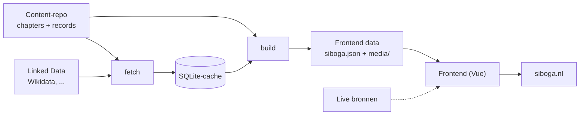

# Architectuur
[Documentatie](README.md) › Architectuur

Een statische website zonder eigen backend. Alles wordt vooraf gegenereerd en als bestanden geserveerd; alleen live bronnen, zoals kaarttegels, haalt de browser zelf op.

## Datastroom


1. Redacteuren schrijven chapters en records in Obsidian ([content-repo.md](content-repo.md)).
2. `fetch` haalt de bronnen van de records op en bewaart ze in SQLite ([pipeline.md](pipeline.md)).
3. `build` combineert content en cache tot de frontend data ([frontend-data.md](frontend-data.md)).
4. De frontend toont alles daaruit, met een URL per item ([frontend.md](frontend.md)).
5. `vite build` maakt er statische bestanden van voor de server ([ontwikkelen.md](ontwikkelen.md)).

## Koppelingen tussen de onderdelen
Elk onderdeel praat met het volgende via één afgesproken formaat, zodat je ze los kunt bouwen en vervangen.
1. **Content → pipeline**: Obsidian-markdown met YAML-frontmatter.
2. **Bron → cache**: één adapter per soort bron.
3. **Pipeline → frontend**: de frontend data. De frontend weet niets van Obsidian, SQLite of Linked Data.
4. **Frontend → live bronnen**: één module per live bron.

## Principes
- **Alles lokaal.** Wat de site toont, plaatjes inbegrepen, staat bij ons. Valt een externe dienst uit, dan bouwen en presenteren we gewoon door.
- **Eerst kopiëren, dan filteren.** De pipeline haalt volledige kopieën op en kiest daarna lokaal wat we tonen.
- **Links blijven links.** Elk item krijgt een URL; interne links wijzen daarheen.
- **De content-repo is alleen bron.** De pipeline schrijft er nooit in.
- **Verdraagzaam.** Onaffe content geeft een waarschuwing, geen crash.
- **Eenvoud.** Het is een hackathon. Bouw het kleinste dat werkt, maar houd de koppelingen heel.

## Indeling van de repo
```
├── CLAUDE.md          ← codeconventies
├── justfile           ← alle commando's
├── docs/
├── content/           ← kloon van de content-repo (niet in git)
├── pipeline/          ← Python (uv)
├── frontend/          ← Vue 3 + Vite
├── etc/               ← nginx
├── expeditie/         ← inhoudelijk overzicht van de expeditie
└── site/              ← huidige placeholder, tot de frontend live gaat
```
