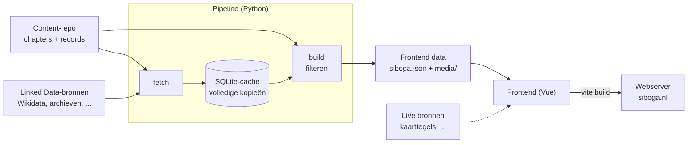

# Architectuur
[Documentatie](README.md) › Architectuur

De Siboga Expeditie is een statische website. Er draait geen eigen backend: alles wat de site nodig heeft, wordt vooraf gegenereerd en als gewone bestanden geserveerd. Alleen live bronnen, zoals de kaarttegels voor de interactieve kaart, haalt de browser zelf op.

## Datastroom


In woorden:
1. Redacteuren schrijven in Obsidian. Er zijn twee soorten bestanden: **chapters** (de verhalen) en **records** (verwijzingen naar Linked Data elders). Zie [content-repo.md](content-repo.md).
2. `fetch` leest de records, haalt van elke bron een volledige kopie op, met alle triples en plaatjes, en bewaart die in SQLite. Zie [pipeline.md](pipeline.md).
3. `build` leest de content opnieuw, filtert uit de cache wat we tonen, zet de interne links om naar URL's en schrijft de frontend data: één `siboga.json` en een map `media/`. Zie [frontend-data.md](frontend-data.md).
4. De frontend laadt `siboga.json` bij het opstarten en toont alles daaruit. Elke chapter en elk record heeft een eigen URL. Live bronnen haalt hij zelf op, met een terugvaloptie. Zie [frontend.md](frontend.md).
5. `vite build` maakt er een statische map van, die naar de server gaat. Zie [ontwikkelen.md](ontwikkelen.md).

## Onderdelen
| Onderdeel | Map | Taal | Verantwoordelijk voor | Documentatie |
|---|---|---|---|---|
| Content | content-repo, lokaal gekloond in `content/` | Obsidian-markdown + YAML | Het verhaal en de verwijzingen naar bronnen | [content-repo.md](content-repo.md) |
| Pipeline | `pipeline/` | Python (uv) | Bronnen ophalen, cachen, filteren, frontend data bouwen | [pipeline.md](pipeline.md) |
| Frontend data | `frontend/public/data/` | JSON + bestanden | Het contract tussen pipeline en frontend | [frontend-data.md](frontend-data.md) |
| Frontend | `frontend/` | Vue 3, JavaScript, SCSS | De website | [frontend.md](frontend.md) |
| Server | `etc/` | nginx | Het serveren van de statische bestanden | [ontwikkelen.md](ontwikkelen.md#server) |

## Naden tussen de onderdelen
Elk onderdeel praat met het volgende via één afgesproken formaat. Daardoor kan elk onderdeel apart gebouwd, getest en vervangen worden.
1. **Content → pipeline**: Obsidian-markdown met YAML-frontmatter en wikilinks. Zie [content-repo.md](content-repo.md).
2. **Bron → cache**: per soort bron één adapter in de pipeline. Een nieuwe bron toevoegen is één nieuw bestand. Zie [pipeline.md](pipeline.md#bronadapters).
3. **Pipeline → frontend**: de frontend data. Dit is de belangrijkste naad. De frontend weet niets van Obsidian, SQLite of Linked Data; hij kent alleen `siboga.json`. Zie [frontend-data.md](frontend-data.md).
4. **Frontend → live bronnen**: per live bron één module in de frontend. Componenten halen nooit zelf data op. Zie [frontend.md](frontend.md#live-bronnen).

## Principes
- **Alles lokaal.** Wat de site toont, staat bij ons: in de cache van de pipeline en in de frontend data, plaatjes inbegrepen. Valt een externe dienst uit, ook midden in de hackathon, dan bouwen en presenteren we gewoon door. Live bronnen hebben een terugvaloptie.
- **Eerst kopiëren, dan filteren.** De pipeline haalt volledige kopieën van de bronnen op en kiest pas daarna lokaal wat we tonen. Zie [pipeline.md](pipeline.md#uitgangspunt-eerst-alles-kopiëren-dan-lokaal-filteren).
- **Links blijven links.** Het netwerk van verwijzingen tussen chapters en records blijft behouden: elk item krijgt een eigen URL, en elke interne link wijst daarheen. Zie [frontend-data.md](frontend-data.md#url-structuur).
- **De content-repo is alleen bron.** De pipeline leest hem en schrijft er nooit in.
- **Statisch.** Geen server-side code. De site werkt met elke webserver die bestanden kan serveren.
- **Modulair.** Eén adapter per bron, één view per scherm, één module per live bron. De frontend is te ontwikkelen met een voorbeeld-JSON, zonder dat de pipeline draait.
- **Verdraagzaam voor content.** Content wordt door mensen geschreven en is vaak onaf. Ontbrekende velden of kapotte links geven een waarschuwing, geen crash.
- **Eenvoud boven volledigheid.** Het is een hackathon. Bouw het kleinste dat werkt, maar houd de naden hierboven heel.

## Voorgestelde indeling van de repo
```
├── CLAUDE.md                ← codeconventies en instructies voor agents
├── README.md
├── justfile                 ← alle commando's op één plek
├── docs/                    ← deze documentatie
├── content/                 ← lokale kloon van de content-repo (niet in git)
├── pipeline/                ← Python, beheerd met uv
│   ├── pyproject.toml
│   ├── defaults.toml        ← standaardconfiguratie (in git)
│   ├── config.toml          ← lokale overschrijvingen (niet in git)
│   ├── cache/               ← SQLite en gedownloade media (niet in git)
│   ├── src/siboga/
│   └── tests/
├── frontend/                ← Vue 3 + Vite, op basis van Hays template vue3-pinia
│   ├── package.json
│   ├── vite.config.js
│   ├── index.html
│   ├── fixtures/            ← voorbeeld-frontend data (in git)
│   ├── public/data/         ← frontend data uit de pipeline (niet in git)
│   └── src/
├── etc/                     ← serverconfiguratie (nginx)
└── expeditie/               ← inhoudelijk overzicht van de expeditie (bestaat al)
```

De map `site/` met de huidige placeholder-pagina blijft staan tot de Vue-frontend live gaat.

## Zie ook
- [README.md](README.md): overzicht van alle documentatie en de begrippen
- [beslissingen.md](beslissingen.md): wat vastligt en wat nog open staat
